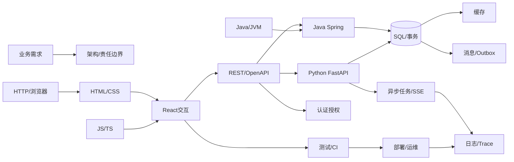

# 全栈知识关系图 V4.1：知识关系固定，学习顺序可变

> 本页为知识架构；W01–W24 是原 [ROADMAP](../../ROADMAP.md) 的覆盖坐标，**不是必须按周打卡的顺序**。新增Vue/Nuxt、桌面、跨端、Node后端及其他语言分支。全景比喻：[全栈脑内地图](FULLSTACK-MENTAL-MODEL.md)；上游资料：[直达索引](UPSTREAM-ASSET-INDEX.md)。机器可读：[knowledge-map.json](knowledge-map.json)。

**每层有什么用**：浏览器发起请求并显示页面，React管理交互状态；契约约束前后端字段；Python或Java实现业务API；SQL负责持久化与并发正确性，Redis加速读取，Celery处理长任务，消息系统解决跨服务事件，认证鉴权保护数据，CI/部署/监控让系统可维护。**并不要求每个下游应用安装全部组件。**

## 阅读规则

- `requires`：该项开始实践所需的**最低概念**；不表示前置模块全部学完、之前的周全部通过。
- `coordinates`：保留的24周知识定位坐标，可以任意跳转，不是日历。
- `gates`：证据归档的能力类别；按需求选相关项验收，无需每个项目全覆盖。
- 权威来源每个节点至少一条官方文档；按任务阅读对应章节，无需把整份文档从头到尾刷完。

## 知识节点索引（用途 / 最小先修 / 官方资料 / 上游实训）

| 编号 | 技术主题 | 专业作用 | 最低先修 | 旧坐标 | 官方原文 | 上游可复用资料 |
|---|---|---|---|---|---|---|
| P01 | 业务需求/验收 | 解决什么问题、什么算成功 | 无 | W24 | [官方](https://docs.github.com/en/issues) | [上游实训/讲解](https://github.com/Xander-Xai/X-SuperPlay-AI-Learning-OS/blob/main/docs/career/market-to-lab-loop.md) |
| P02 | 架构与技术取舍 | 模块边界、数据归属、技术选型 | P01 | W24 | [官方](https://learn.microsoft.com/en-us/azure/architecture/) | [上游实训/讲解](https://github.com/Xander-Xai/X-SuperPlay-AI-Learning-OS/blob/main/docs/career/ai-product-engineer-roadmap-20261028.md) |
| F01 | Web/HTTP/浏览器 | 请求、Cookie、状态码、CORS、TLS | 无 | W01、W05 | [官方](https://developer.mozilla.org/en-US/docs/Web/HTTP) | [上游实训/讲解](https://github.com/Xander-Xai/X-SuperPlay-AI-Learning-OS/blob/main/docs/tracks/project-driven/ai-native-fullstack-track.md) |
| F02 | HTML/CSS/无障碍 | 布局、语义表单、响应式与键盘操作 | 无 | W02、W14 | [官方](https://developer.mozilla.org/en-US/docs/Learn_web_development) | [上游实训/讲解](https://github.com/Xander-Xai/X-SuperPlay-AI-Learning-OS/blob/main/docs/tracks/project-driven/ai-native-fullstack-track.md) |
| F03 | JavaScript/TypeScript | 事件循环、异步取消、泛型、模块 | 无 | W01、W15 | [官方](https://www.typescriptlang.org/docs/handbook/) | [上游实训/讲解](https://github.com/Xander-Xai/X-SuperPlay-AI-Learning-OS/blob/main/docs/knowledge/software-engineering/programming-language-stack-map.md) |
| F04 | React/状态 | 组件、路由、服务端数据与交互 | F02、F03 | W02、W16 | [官方](https://react.dev/learn) | [上游实训/讲解](https://github.com/Xander-Xai/X-SuperPlay-AI-Learning-OS/blob/main/docs/tracks/project-driven/ai-native-fullstack-track.md) |
| F05 | Next.js/SSR | 按SEO、缓存、服务端边界选择渲染 | F02、F03 | W17 | [官方](https://nextjs.org/docs/app) | [上游实训/讲解](https://github.com/Xander-Xai/X-SuperPlay-AI-Learning-OS/blob/main/docs/knowledge/software-engineering/programming-language-stack-map.md) |
| F06 | Node.js/Streams | 服务端JS、BFF和流背压 | F03 | W18 | [官方](https://nodejs.org/en/learn) | [上游实训/讲解](https://github.com/Xander-Xai/X-SuperPlay-AI-Learning-OS/blob/main/docs/knowledge/software-engineering/programming-language-stack-map.md) |
| F07 | 构建与前端性能 | ESM、Vite、分包、Profiler | F03 | W15、W16、W23 | [官方](https://vite.dev/guide/) | [上游实训/讲解](https://github.com/Xander-Xai/X-SuperPlay-AI-Learning-OS/blob/main/docs/knowledge/software-engineering/programming-language-stack-map.md) |
| B01 | REST/OpenAPI | 定义前后端契约、类型与错误 | F01 | W03 | [官方](https://spec.openapis.org/oas/latest.html) | [上游实训/讲解](https://github.com/Xander-Xai/X-SuperPlay-AI-Learning-OS/blob/main/docs/tracks/project-driven/lab-guides/LAB02.md) |
| B02 | Python/FastAPI | 请求校验、业务逻辑、分层与测试 | F01 | W03、W05 | [官方](https://fastapi.tiangolo.com/tutorial/) | [上游实训/讲解](https://github.com/Xander-Xai/X-SuperPlay-AI-Learning-OS/blob/main/docs/tracks/project-driven/lab-guides/LAB02.md) |
| B03 | Java/JVM | 集合/泛型、JMM、线程、GC/JFR | 无 | W09、W10、W11 | [官方](https://dev.java/learn/) | [上游实训/讲解](https://github.com/Xander-Xai/X-SuperPlay-AI-Learning-OS/blob/main/docs/tracks/project-driven/lab-guides/LAB14.md) |
| B04 | Spring Boot/MVC | Bean/IoC、Web服务、异常映射 | B03、F01 | W12 | [官方](https://docs.spring.io/spring-boot/reference/) | [上游实训/讲解](https://github.com/Xander-Xai/X-SuperPlay-AI-Learning-OS/blob/main/docs/tracks/project-driven/lab-guides/LAB14.md) |
| B05 | Spring Data/Security | 数据库事务、ORM、服务端权限 | B04、D01 | W13 | [官方](https://docs.spring.io/spring-security/reference/) | [上游实训/讲解](https://github.com/Xander-Xai/X-SuperPlay-AI-Learning-OS/blob/main/docs/tracks/project-driven/lab-guides/LAB14.md) |
| B06 | Celery/SSE | 后台状态、幂等、流式进度与恢复 | B02 | W06 | [官方](https://docs.celeryq.dev/en/stable/userguide/tasks.html) | [上游实训/讲解](https://github.com/Xander-Xai/X-SuperPlay-AI-Learning-OS/blob/main/docs/tracks/project-driven/lab-guides/LAB02.md) |
| D01 | PostgreSQL/SQL | 持久化、MVCC、事务、索引 | 无 | W04 | [官方](https://www.postgresql.org/docs/current/) | [上游实训/讲解](https://github.com/Xander-Xai/X-SuperPlay-AI-Learning-OS/blob/main/docs/tracks/project-driven/lab-guides/LAB08.md) |
| D02 | Redis/缓存 | TTL、缓存击穿、失效与一致性 | 无 | W04、W20 | [官方](https://redis.io/docs/latest/) | [上游实训/讲解](https://github.com/Xander-Xai/X-SuperPlay-AI-Learning-OS/blob/main/docs/tracks/project-driven/lab-guides/LAB08.md) |
| D03 | 消息/Outbox | 跨服务事件的可靠交付和幂等 | D01 | W19、W20 | [官方](https://www.rabbitmq.com/docs) | [上游实训/讲解](https://github.com/Xander-Xai/X-SuperPlay-AI-Learning-OS/blob/main/docs/tracks/project-driven/enterprise-ai-application-capstone.md) |
| D04 | MySQL差异 | 比较InnoDB与PG事务和索引 | 无 | W20 | [官方](https://dev.mysql.com/doc/) | [上游实训/讲解](https://github.com/Xander-Xai/X-SuperPlay-AI-Learning-OS/blob/main/docs/knowledge/software-engineering/programming-language-stack-map.md) |
| E01 | Git/测试/CI | 回归、审查、自动验证 | 无 | W07 | [官方](https://docs.github.com/en/actions) | [上游实训/讲解](https://github.com/Xander-Xai/X-SuperPlay-AI-Learning-OS/blob/main/docs/tracks/project-driven/lab-guides/LAB11.md) |
| E02 | Docker/Linux/部署 | 运行环境、HTTPS、备份与回滚 | F01 | W07、W22 | [官方](https://docs.docker.com/get-started/) | [上游实训/讲解](https://github.com/Xander-Xai/X-SuperPlay-AI-Learning-OS/blob/main/docs/tracks/project-driven/lab-guides/LAB11.md) |
| E03 | 身份/权限/多租户 | Cookie、OAuth/OIDC、资源级授权 | F01 | W05、W21 | [官方](https://owasp.org/API-Security/) | [上游实训/讲解](https://github.com/Xander-Xai/X-SuperPlay-AI-Learning-OS/blob/main/docs/tracks/project-driven/lab-guides/LAB09.md) |
| E04 | Trace/性能/排障 | 日志、OpenTelemetry、P95、JFR | 无 | W08、W23 | [官方](https://opentelemetry.io/docs/) | [上游实训/讲解](https://github.com/Xander-Xai/X-SuperPlay-AI-Learning-OS/blob/main/docs/tracks/project-driven/lab-guides/LAB07.md) |
| P03 | 生产发布/运营 | UAT、监控、成本、恢复责任 | P01、E01 | W22、W24 | [官方](https://docs.github.com/en/actions) | [上游实训/讲解](https://github.com/Xander-Xai/X-SuperPlay-AI-Learning-OS/blob/main/docs/career/opc-multiplatform-product-engineer-roadmap-20261028.md) |
| U01 | 静态工具站/SEO | 纯浏览器工具与静态发布 | F02、F03 | W14、W17 | [官方](https://web.dev/learn/seo) | [上游实训/讲解](https://github.com/Xander-Xai/X-SuperPlay-AI-Learning-OS/blob/main/docs/sources/ai-native-multiplatform-research-20261028.md) |
| M01 | 微信小程序 | 平台生命周期、真机与审核 | F03 | W24 | [官方](https://developers.weixin.qq.com/miniprogram/dev/framework/) | [上游实训/讲解](https://github.com/Xander-Xai/X-SuperPlay-AI-Learning-OS/blob/main/docs/tracks/project-driven/ai-native-multiplatform-track.md) |
| M02 | 移动App | 设备权限、离线、签名与应用商店 | 无 | W24 | [官方](https://docs.expo.dev/) | [上游实训/讲解](https://github.com/Xander-Xai/X-SuperPlay-AI-Learning-OS/blob/main/docs/assessments/ai-native-multiplatform-rubric.md) |
| A01 | AI/RAG/Agent | 模型/工具契约、评测和安全降级 | B01 | W24 | [官方](https://docs.langchain.com/oss/python/langgraph/overview) | [上游实训/讲解](https://github.com/Xander-Xai/X-SuperPlay-AI-Learning-OS/blob/main/docs/tracks/project-driven/enterprise-ai-application-capstone.md) |
| P04 | 支付/订阅 | 沙箱回调、验签、幂等与对账 | B01、E03 | W24 | [官方](https://docs.stripe.com/payments) | [上游实训/讲解](https://github.com/Xander-Xai/X-SuperPlay-AI-Learning-OS/blob/main/docs/labs/freelance-proof-20261025/README.md) |
| F08 | Vue 3/响应式/状态 | Vue的Composition API、ref/reactive/watch/路由与前端状态 | F02、F03 | W02、W16 | [官方](https://vuejs.org/guide/introduction) | [上游实训/讲解](https://github.com/Xander-Xai/X-SuperPlay-AI-Learning-OS/blob/main/docs/tracks/project-driven/ai-native-fullstack-track.md) |
| F09 | Nuxt/SSR与混合渲染 | Vue生态的全栈路由、SSR/CSR/Hybrid、数据与缓存边界 | F08、F01 | W17 | [官方](https://learn.nuxt.com/en/concepts/rendering-modes) | [上游实训/讲解](https://github.com/Xander-Xai/X-SuperPlay-AI-Learning-OS/blob/main/docs/knowledge/software-engineering/programming-language-stack-map.md) |
| F10 | PWA/Service Worker/浏览器存储 | 离线缓存、浏览器生命周期、资源与业务数据缓存边界 | F01、F03 | W14、W17 | [官方](https://developer.mozilla.org/en-US/docs/Web/Progressive_web_apps/Guides/Offline_and_background_operation) | [上游实训/讲解](https://github.com/Xander-Xai/X-SuperPlay-AI-Learning-OS/blob/main/docs/sources/ai-native-multiplatform-research-20261028.md) |
| F11 | WebSocket/实时通信协议 | 区分HTTP轮询、SSE单向事件、WebSocket双向连接和断线策略 | F01 | W06、W18 | [官方](https://developer.mozilla.org/en-US/docs/Web/API/WebSockets_API) | [上游实训/讲解](https://github.com/Xander-Xai/X-SuperPlay-AI-Learning-OS/blob/main/docs/tracks/project-driven/lab-guides/LAB02.md) |
| B07 | Node后端/NestJS/Express | Node运行时上的Controller/服务/依赖注入/API架构 | F06、F01 | W18 | [官方](https://docs.nestjs.com/first-steps) | [上游实训/讲解](https://github.com/Xander-Xai/X-SuperPlay-AI-Learning-OS/blob/main/docs/knowledge/software-engineering/programming-language-stack-map.md) |
| B08 | Go服务与并发 | Go编译/模块/interface/goroutine/context与HTTP服务 | F01 | W24 | [官方](https://go.dev/learn/) | [上游实训/讲解](https://github.com/Xander-Xai/X-SuperPlay-AI-Learning-OS/blob/main/docs/knowledge/software-engineering/programming-language-stack-map.md) |
| B09 | Rust/C++/CUDA原生能力 | 原生模块、内存与并发安全、推理/性能约束下的系统编程 | 无 | W24 | [官方](https://doc.rust-lang.org/stable/book/) | [上游实训/讲解](https://github.com/Xander-Xai/X-SuperPlay-AI-Learning-OS/blob/main/docs/knowledge/software-engineering/programming-language-stack-map.md) |
| D05 | 对象存储/全文搜索/向量数据库 | 文件、业务数据、全文检索与向量检索的不同存储责任 | B01 | W20、W24 | [官方](https://www.postgresql.org/docs/current/textsearch.html) | [上游实训/讲解](https://github.com/Xander-Xai/X-SuperPlay-AI-Learning-OS/blob/main/docs/tracks/project-driven/lab-guides/LAB03.md) |
| E05 | 编译/构建/打包/运行时 | JS构建、Python依赖/虚拟环境、JVM JAR、Go/Rust二进制的区别 | 无 | W07、W15、W22 | [官方](https://vite.dev/guide/) | [上游实训/讲解](https://github.com/Xander-Xai/X-SuperPlay-AI-Learning-OS/blob/main/docs/knowledge/software-engineering/programming-language-stack-map.md) |
| M03 | Electron/Tauri桌面应用 | 桌面Web视图、系统API、主/渲染进程或Rust命令与安全边界 | F02、F03 | W24 | [官方](https://www.electronjs.org/docs/latest/tutorial/process-model) | [上游实训/讲解](https://github.com/Xander-Xai/X-SuperPlay-AI-Learning-OS/blob/main/docs/career/opc-multiplatform-product-engineer-roadmap-20261028.md) |
| M04 | uni-app/跨端小程序生态 | 基于Vue的多端页面抽象与目标平台API/审核差异 | F08 | W24 | [官方](https://uniapp.dcloud.net.cn/) | [上游实训/讲解](https://github.com/Xander-Xai/X-SuperPlay-AI-Learning-OS/blob/main/docs/tracks/project-driven/ai-native-multiplatform-track.md) |
| M05 | Android/iOS原生开发 | Kotlin/Jetpack Compose或Swift/SwiftUI的设备与原生SDK能力 | M02 | W24 | [官方](https://developer.android.com/jetpack/compose) | [上游实训/讲解](https://github.com/Xander-Xai/X-SuperPlay-AI-Learning-OS/blob/main/docs/career/opc-multiplatform-product-engineer-roadmap-20261028.md) |
| A02 | MCP工具接口/Agent协议 | MCP工具/资源/提示的客户端服务端约定，区分REST和A2A | 无 | W24 | [官方](https://modelcontextprotocol.io/docs/learn/architecture) | [上游实训/讲解](https://github.com/Xander-Xai/X-SuperPlay-AI-Learning-OS/blob/main/docs/tracks/project-driven/lab-guides/LAB06.md) |

## 新增跨栈分支的直觉、边界与最小实战

- **F08 Vue 3/响应式/状态**：Vue是UI框架；与React是平行选型，不是React的前置步骤。最小实战：Vue列表请求逆序、watch清理、键盘可用表单。
- **F09 Nuxt/SSR与混合渲染**：Nuxt是Vue全栈应用框架，不是Vite的替代版本。最小实战：比较Nuxt服务端/浏览器HTML和hydration行为。
- **F10 PWA/Service Worker/浏览器存储**：Service Worker像离线接待员，并非永不下线的后台进程。最小实战：断网后受控读缓存，登录切换时不泄露他人数据。
- **F11 WebSocket/实时通信协议**：WebSocket是双向管道，但不是持久消息数据库。最小实战：模拟断开重连、消息乱序和发送速度超过消费速度。
- **B07 Node后端/NestJS/Express**：Node是运行时，Nest是框架，与FastAPI/Spring平行。最小实战：做Nest/Express最小CRUD并验证400/401/500及进程重启。
- **B08 Go服务与并发**：Go按已有Go系统或性能/部署限制触发，不是必修后端。最小实战：写最小HTTP服务并复现取消上下文/并发数据竞争。
- **B09 Rust/C++/CUDA原生能力**：Rust/C++/CUDA是按需性能或平台分支，不是学习全栈必经门槛。最小实战：独立原生小程序或Rust CLI；仅有目标瓶颈才做CUDA/C++对照。
- **D05 对象存储/全文搜索/向量数据库**：数据库不是把所有文件塞一张表；向量检索不是业务权限系统。最小实战：文件元数据与原始对象分离，比较文本与向量召回负例。
- **E05 编译/构建/打包/运行时**：源代码≠构建产物≠容器≠生产部署。最小实战：对比npm build、Python安装/启动、Maven打包与实际进程。
- **M03 Electron/Tauri桌面应用**：桌面UI看起来像网页，但本地文件系统权限和安装签名不同。最小实战：做本地文件对话框并拒绝未授权的任意文件路径访问。
- **M04 uni-app/跨端小程序生态**：同一套语法可复用不代表各平台行为与审核完全一致。最小实战：同一受控页面在H5与小程序目标环境运行并对照行为。
- **M05 Android/iOS原生开发**：原生功能/设备限制真正出现再选一个平台，不强行同时学。最小实战：Android原生权限负例或有授权设备的iOS构建演示。
- **A02 MCP工具接口/Agent协议**：MCP是AI上下文和工具互操作协议，不是REST或通用消息队列的替代品。最小实战：最小MCP工具定义+非法参数/拒绝未授权调用。

## 典型跨知识点关系

- 做React或Vue表格：F02/F03（最低）→F04；需要联调再接F01/B01，服务端按实际选B02或B04。
- 做Spring接口：B03最少Java对象/泛型→B04；涉及ORM/事务才进入D01/B05。**不必先完成W1–W11**。
- 做SSE任务：B06关联D01持久状态和F04前端进度；跨服务消息才考虑D03。
- 做静态工具：U01+F02/F03+E01/E02适用部分；Java/数据库可能完全没有必要。
- 做小程序/移动端：M01或M02按平台进入；根据具体API需要再学B01/E03。
- 做AI应用：A01需B01接口契约，真实接入通常关联E03权限、E04追踪/评测，但模型能力不能替代普通工程。

如何执行详见：[需求驱动入口](DEMAND-ROUTER.md)、[官方资料库](OFFICIAL-RESOURCES.md)、[Gap模板](GAP-SESSION-TEMPLATE.md)。
