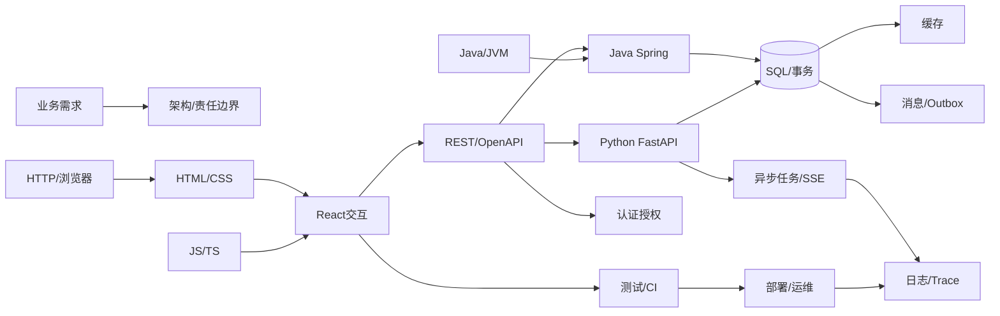

# 全栈知识关系图 V4.0：知识关系固定，学习顺序可变

> 本页为知识架构；W01–W24 是原 [ROADMAP](../../ROADMAP.md) 的覆盖坐标，**不是必须按周打卡的顺序**。机器可读：[knowledge-map.json](knowledge-map.json)。

**每层有什么用**：浏览器发起请求并显示页面，React管理交互状态；契约约束前后端字段；Python或Java实现业务API；SQL负责持久化与并发正确性，Redis加速读取，Celery处理长任务，消息系统解决跨服务事件，认证鉴权保护数据，CI/部署/监控让系统可维护。**并不要求每个下游应用安装全部组件。**

## 阅读规则

- `requires`：该项开始实践所需的**最低概念**；不表示前置模块全部学完、之前的周全部通过。
- `coordinates`：保留的24周知识定位坐标，可以任意跳转，不是日历。
- `gates`：证据归档的能力类别；按需求选相关项验收，无需每个项目全覆盖。
- 权威来源每个节点至少一条官方文档；按任务阅读对应章节，无需把整份文档从头到尾刷完。

## 知识节点索引

| 编号 | 知识点 | 作用 | 最小先修 | 旧坐标 | 权威资料 |
|---|---|---|---|---|---|
| P01 | 业务需求/验收 | 解决什么问题、什么算成功 | 无 | W24 | [官方文档](https://docs.github.com/en/issues) |
| P02 | 架构与技术取舍 | 模块边界、数据归属、技术选型 | P01 | W24 | [官方文档](https://learn.microsoft.com/en-us/azure/architecture/) |
| F01 | Web/HTTP/浏览器 | 请求、Cookie、状态码、CORS、TLS | 无 | W01、W05 | [官方文档](https://developer.mozilla.org/en-US/docs/Web/HTTP) |
| F02 | HTML/CSS/无障碍 | 布局、语义表单、响应式与键盘操作 | 无 | W02、W14 | [官方文档](https://developer.mozilla.org/en-US/docs/Learn_web_development) |
| F03 | JavaScript/TypeScript | 事件循环、异步取消、泛型、模块 | 无 | W01、W15 | [官方文档](https://www.typescriptlang.org/docs/handbook/) |
| F04 | React/状态 | 组件、路由、服务端数据与交互 | F02、F03 | W02、W16 | [官方文档](https://react.dev/learn) |
| F05 | Next.js/SSR | 按SEO、缓存、服务端边界选择渲染 | F02、F03 | W17 | [官方文档](https://nextjs.org/docs/app) |
| F06 | Node.js/Streams | 服务端JS、BFF和流背压 | F03 | W18 | [官方文档](https://nodejs.org/en/learn) |
| F07 | 构建与前端性能 | ESM、Vite、分包、Profiler | F03 | W15、W16、W23 | [官方文档](https://vite.dev/guide/) |
| B01 | REST/OpenAPI | 定义前后端契约、类型与错误 | F01 | W03 | [官方文档](https://spec.openapis.org/oas/latest.html) |
| B02 | Python/FastAPI | 请求校验、业务逻辑、分层与测试 | F01 | W03、W05 | [官方文档](https://fastapi.tiangolo.com/tutorial/) |
| B03 | Java/JVM | 集合/泛型、JMM、线程、GC/JFR | 无 | W09、W10、W11 | [官方文档](https://dev.java/learn/) |
| B04 | Spring Boot/MVC | Bean/IoC、Web服务、异常映射 | B03、F01 | W12 | [官方文档](https://docs.spring.io/spring-boot/reference/) |
| B05 | Spring Data/Security | 数据库事务、ORM、服务端权限 | B04、D01 | W13 | [官方文档](https://docs.spring.io/spring-security/reference/) |
| B06 | Celery/SSE | 后台状态、幂等、流式进度与恢复 | B02 | W06 | [官方文档](https://docs.celeryq.dev/en/stable/userguide/tasks.html) |
| D01 | PostgreSQL/SQL | 持久化、MVCC、事务、索引 | 无 | W04 | [官方文档](https://www.postgresql.org/docs/current/) |
| D02 | Redis/缓存 | TTL、缓存击穿、失效与一致性 | 无 | W04、W20 | [官方文档](https://redis.io/docs/latest/) |
| D03 | 消息/Outbox | 跨服务事件的可靠交付和幂等 | D01 | W19、W20 | [官方文档](https://www.rabbitmq.com/docs) |
| D04 | MySQL差异 | 比较InnoDB与PG事务和索引 | 无 | W20 | [官方文档](https://dev.mysql.com/doc/) |
| E01 | Git/测试/CI | 回归、审查、自动验证 | 无 | W07 | [官方文档](https://docs.github.com/en/actions) |
| E02 | Docker/Linux/部署 | 运行环境、HTTPS、备份与回滚 | F01 | W07、W22 | [官方文档](https://docs.docker.com/get-started/) |
| E03 | 身份/权限/多租户 | Cookie、OAuth/OIDC、资源级授权 | F01 | W05、W21 | [官方文档](https://owasp.org/API-Security/) |
| E04 | Trace/性能/排障 | 日志、OpenTelemetry、P95、JFR | 无 | W08、W23 | [官方文档](https://opentelemetry.io/docs/) |
| P03 | 生产发布/运营 | UAT、监控、成本、恢复责任 | P01、E01 | W22、W24 | [官方文档](https://docs.github.com/en/actions) |
| U01 | 静态工具站/SEO | 纯浏览器工具与静态发布 | F02、F03 | W14、W17 | [官方文档](https://web.dev/learn/seo) |
| M01 | 微信小程序 | 平台生命周期、真机与审核 | F03 | W24 | [官方文档](https://developers.weixin.qq.com/miniprogram/dev/framework/) |
| M02 | 移动App | 设备权限、离线、签名与应用商店 | 无 | W24 | [官方文档](https://docs.expo.dev/) |
| A01 | AI/RAG/Agent | 模型/工具契约、评测和安全降级 | B01 | W24 | [官方文档](https://docs.langchain.com/oss/python/langgraph/overview) |
| P04 | 支付/订阅 | 沙箱回调、验签、幂等与对账 | B01、E03 | W24 | [官方文档](https://docs.stripe.com/payments) |

## 典型跨知识点关系

- 做React表格：F02/F03（最低）→F04；需要联调再接F01/B01，服务端按实际选B02或B04。
- 做Spring接口：B03最少Java对象/泛型→B04；涉及ORM/事务才进入D01/B05。**不必先完成W1–W11**。
- 做SSE任务：B06关联D01持久状态和F04前端进度；跨服务消息才考虑D03。
- 做静态工具：U01+F02/F03+E01/E02适用部分；Java/数据库可能完全没有必要。
- 做小程序/移动端：M01或M02按平台进入；根据具体API需要再学B01/E03。
- 做AI应用：A01需B01接口契约，真实接入通常关联E03权限、E04追踪/评测，但模型能力不能替代普通工程。

如何执行详见：[需求驱动入口](DEMAND-ROUTER.md)、[官方资料库](OFFICIAL-RESOURCES.md)、[Gap模板](GAP-SESSION-TEMPLATE.md)。
